# Machinista

[Repository](https://github.com/photogeen/machinista) · [Issues](https://github.com/photogeen/machinista/issues)

Make beats, play instruments and turn loops into songs - directly from your
controller. Machinista runs on a Raspberry Pi, so you can make music without
keeping a laptop connected. Use your own recordings or start playing with the
built-in Machinista Synth and its ready-made sounds.

**Pi 3B testing is paused.** The experimental sampler-only image is not recommended for beta testers because controller/network stability and CPU usage need further investigation. Use Pi 4 or Pi 5 for this release.

**Machinista is currently a beta for Raspberry Pi 4 and Pi 5.** It is ready for
musicians to try and help test, but it still needs testing with different
controllers and audio devices. Save backups of work you want to keep.

[Beschreibung auf Deutsch](docs/OVERVIEW_DE.md)

## How does it connect?

**Machinista runs on the Raspberry Pi. Your controller supplies the pads, knobs
and displays.** Its firmware is not replaced. To use your usual Maschine
software again, reconnect the controller to your computer.

- **MK3 / Maschine+:** you can use the controller's built-in audio inputs,
  headphone output and line outputs. Audio and controls use the same USB link.
- **Mikro / MK1 / MK2:** connect a supported USB audio interface or audio HAT to
  the Pi. Plug headphones or speakers into that audio device.
- **Storage:** the SD card holds the system and can also hold your music.
  Optional USB storage adds room for samples and backups.
- **Browser:** a phone, tablet or computer is optional for file transfers and
  detailed editing. The controller handles normal music making.
- **Maschine+:** use Controller mode with an external Pi. This does not install
  Machinista inside the Maschine+.

A computer is needed once to prepare the SD card. A Pi is still a computer;
this setup lets you play without a laptop, monitor or mouse beside it.

[Step-by-step setup](docs/INSTALL.md) · [Deutsch](docs/OVERVIEW_DE.md) ·
[Compatible plug-in downloads](docs/PLUGIN_PORTS.md)

## What can I make with it?

- **Beats:** play drums on the pads, record a repeating phrase, or place hits one
  step at a time. Correct individual notes afterwards.
- **Sample-based music:** record audio, load WAV/MP3 files, cut loops into playable
  slices, and turn several recordings into one keyboard instrument.
- **Synth parts:** play the built-in four-oscillator synth, choose a ready-made
  patch (a saved sound), and adjust it with the controller or browser editor.
- **Chords and melodies:** play notes across the pads, choose a scale, put a chord
  on one pad, or use Note Repeat and an arpeggiator for rhythmic patterns.
- **Whole songs:** combine Patterns (repeating phrases) into Scenes (song sections),
  then put those sections in order, or arrange independent Pattern clips on the
  [Clip Arranger timeline](docs/CLIP_ARRANGER.md). Record knob movements as automation.
- **Live performances:** mute parts, balance sounds in the Mixer and play effects
  with the pads. Ducktor can lower one sound when another plays - for example,
  making room in the bass whenever the kick hits.
- **Audio loops:** record a loop that plays with your Pattern, or bounce a playing
  part to another pad to keep working with it as audio.
- **Built-in studio effects:** EQ, compressor, limiter, transient shaping, Room/Hall/Plate reverb, stereo delay and six modulation effects. Use them on sounds, groups or the master, and record parameter changes. No extra plug-in installation is needed.
- **Extra instruments and effects:** install compatible LV2 plug-ins. LV2 is the
  add-on format; the public image does not include third-party plug-ins.
- **External gear:** play from a MIDI keyboard, control an external instrument,
  use supported Bluetooth MIDI devices, and choose audio inputs and outputs.
- **Share your music:** [export WAV, AIFF or MP3](docs/MP3_EXPORT.md), with MP3 quality from 128 to 320 kbit/s.
- **Separate samples:** optional [local four-stem separation](docs/STEM_SEPARATION.md) in the WebUI creates vocals, drums, bass and other parts from short samples. Requires a separate engine/model download and enough free RAM.
- **Sample kits and expansions:** build kits in the [Sample Kits editor](docs/SAMPLE_SETS.md), with named banks, 4×4 pads, drag-and-drop and browser preview. Import audio folders, MPC sample programs and readable Maschine expansion samples.
- **Easy file management:** open the WebUI (a browser control page) on a phone,
  tablet or computer to upload samples, back up projects and organize Sounds.

## What do I need?

A Raspberry Pi 4 or 5 with its power supply, an SD card of at least 8 GB, a
supported controller below, and a supported audio device for headphones or
speakers. A computer is needed to prepare the SD card. Afterwards, use the
controller to make music; the browser page is there when you want easier file
management or more detailed editing. The public image includes synth sounds,
but no drum samples or personal recordings.

## Controller support

| Controller | Displays |
| --- | --- |
| Maschine Mikro MK1 / Mikro MK2 | Single monochrome |
| Maschine MK1 / MK2 | Dual monochrome |
| Maschine MK3 | Dual color |
| Maschine+ in controller mode | Dual color |

For Maschine+, switch the unit to Controller mode and connect it to the Pi.
Machinista runs on the Pi; it does not replace the software inside Maschine+.

## Install the beta

[Download the Pi 4 / Pi 5 beta image](https://github.com/photogeen/machinista/releases/tag/v0.1.0-beta.21)
for first installation. Use the `.img.xz` and verify `SHA256SUMS`, then write it to
a spare SD card with Raspberry Pi Imager. Writing erases that card. First boot,
hotspot and account instructions are in [Installation](docs/INSTALL.md).

Existing installations use System / WebUI > Updates. A new SD image is needed
for first installation, not every application update. Beta images still need
real controller/audio and Pi-model testing.

## User manuals / Bedienungsanleitungen

[Read online / Online lesen](https://photogeen.github.io/machinista/) — English & Deutsch.

Illustrated guides with workflows, button explanations and screen references.
Bebilderte Anleitungen mit Arbeitsabläufen, Tasten und Displayübersichten.

| Controller | English | Deutsch |
| --- | --- | --- |
| Mikro MK1 / MK2 | [HTML](https://photogeen.github.io/machinista/mikro-en.html) · [PDF](https://github.com/photogeen/machinista/releases/download/v0.1.0-beta.21/Machinista_Mikro_MK1_User_Manual_EN.pdf) | [HTML](https://photogeen.github.io/machinista/mikro-de.html) · [PDF](https://github.com/photogeen/machinista/releases/download/v0.1.0-beta.21/Machinista_Mikro_MK1_User_Manual_DE.pdf) |
| MK1 | [HTML](https://photogeen.github.io/machinista/mk1-en.html) · [PDF](https://github.com/photogeen/machinista/releases/download/v0.1.0-beta.21/Machinista_MK1_User_Manual_EN.pdf) | [HTML](https://photogeen.github.io/machinista/mk1-de.html) · [PDF](https://github.com/photogeen/machinista/releases/download/v0.1.0-beta.21/Machinista_MK1_User_Manual_DE.pdf) |
| MK2 | [HTML](https://photogeen.github.io/machinista/mk2-en.html) · [PDF](https://github.com/photogeen/machinista/releases/download/v0.1.0-beta.21/Machinista_MK2_User_Manual_EN.pdf) | [HTML](https://photogeen.github.io/machinista/mk2-de.html) · [PDF](https://github.com/photogeen/machinista/releases/download/v0.1.0-beta.21/Machinista_MK2_User_Manual_DE.pdf) |
| MK3 / Maschine+ controller mode | [HTML](https://photogeen.github.io/machinista/mk3-en.html) · [PDF](https://github.com/photogeen/machinista/releases/download/v0.1.0-beta.21/Machinista_MK3_User_Manual_EN.pdf) | [HTML](https://photogeen.github.io/machinista/mk3-de.html) · [PDF](https://github.com/photogeen/machinista/releases/download/v0.1.0-beta.21/Machinista_MK3_User_Manual_DE.pdf) |

[All manuals as ZIP / Alle Anleitungen als ZIP](https://github.com/photogeen/machinista/releases/download/v0.1.0-beta.21/Machinista-Manuals-EN-DE.zip) · [Guide details](docs/USER_MANUALS.md)

## Screens

Actual application renderers with illustrative project data, not hardware photos.
Mikro images also represent Mikro MK2; MK2 screens represent MK1/MK2;
MK3 color screens also apply to Maschine+ in controller mode.

| Feature | Mikro | MK1 / MK2 | MK3 / Maschine+ |
| --- | --- | --- | --- |
| Synth and patch banks | 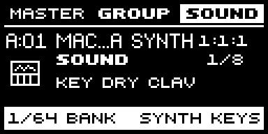 | 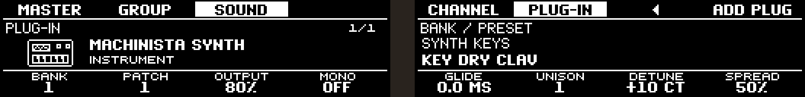 | 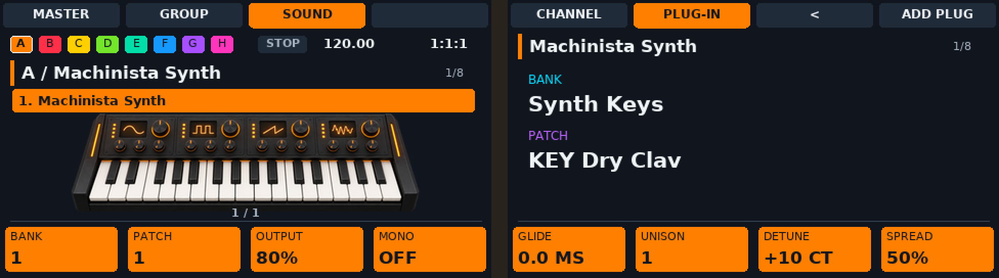 |
| Slice editing | 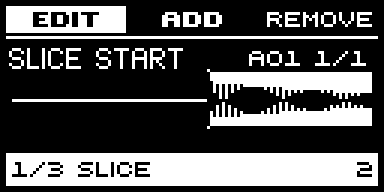 | 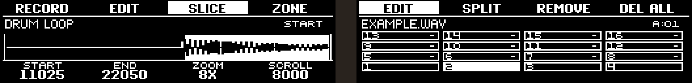 | 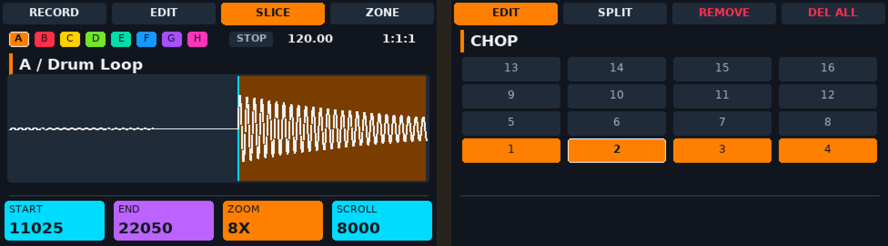 |
| Events / note editing | 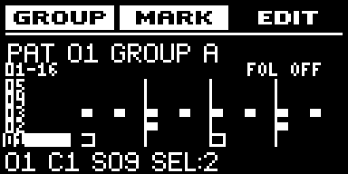 | 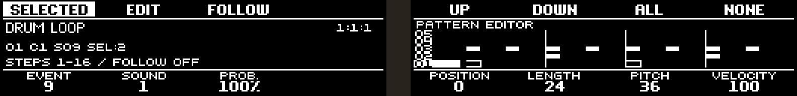 | 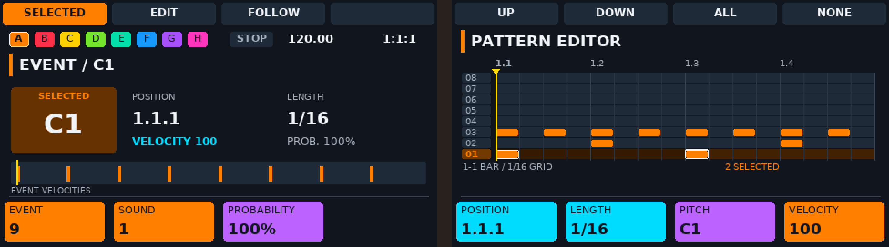 |
| Mixer | 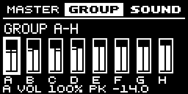 | 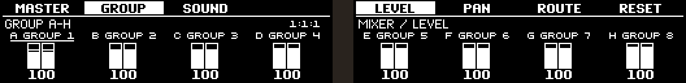 | 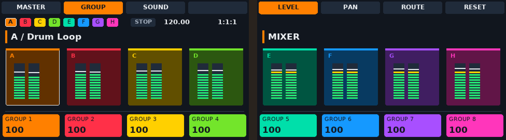 |
| Custom chords | 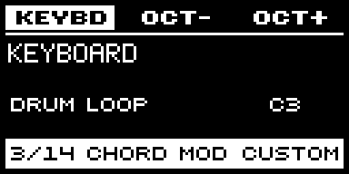 | 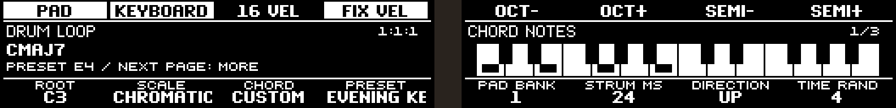 | 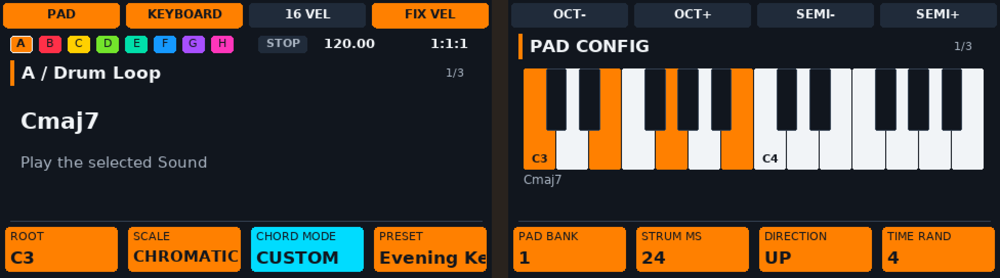 |
| Live effects | 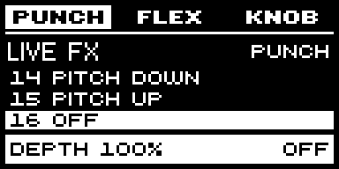 | 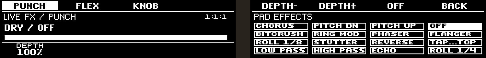 | 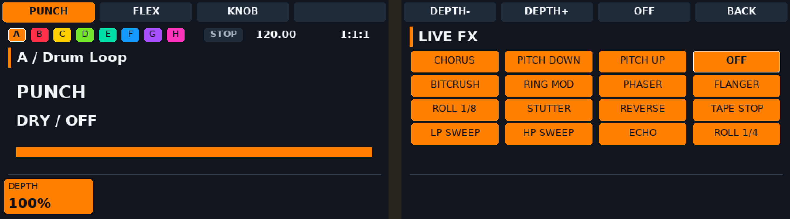 |

[Full-size screen gallery](assets/screens/README.md).

## Learn to use it

Start with [installation and first sound](docs/INSTALL.md), then choose the
[illustrated manual for your controller](docs/USER_MANUALS.md). Each manual
starts with setup, a first sound and a first beat. You can look up the editing
and reference chapters later; you do not need to learn every page first.

The [WebUI guide](docs/WEB_UI.md) explains the browser controls. For making
instruments from several recordings, see [Sounds and Autosampler](docs/SOUNDS_AND_AUTOSAMPLER.md).

## For developers

You do not need to build or program anything to use the prepared SD-card image.
If you want to change the software, see [building from source](docs/BUILD.md),
[software structure](docs/ARCHITECTURE.md), [plug-in profiles](docs/PLUGIN_PROFILES.md)
and [release preparation](docs/GITHUB_PUBLISH.md).
The audio engine uses C++20; controller and browser workflows use Python.
The public repository excludes personal samples, projects, passwords, ROMs and
third-party LV2 binaries. Images and PDFs are provided as release downloads.

## Network access

On a configured image the WebUI is available at `http://machinista.local:8080`.
Without a router connection, the fallback hotspot is `Machinista-XXXX`, password
`machinista`, with the WebUI at `http://10.42.0.1:8080`.
The WebUI has no login and is intended for a trusted local network. Keep it off
public internet interfaces. See [security guidance](SECURITY.md).

## Help test another controller

Open **[Controller Lab](https://photogeen.github.io/machinista/controller-survey/)** in desktop Chrome or Edge, choose your model, connect and click **Start mapping**. Check the displays first; button presses/releases and a clockwise encoder turn then advance automatically. Tested displays also show the current instruction. No test app installation is needed. Send the downloaded JSON in **#controllers** on [Discord](https://discord.gg/3B8mQMyQR) or email to machinista@photogeen.com. The assistant opens the destination; attach and send the file yourself.

Includes model checklists for Maschine Studio, Jam, Mikro MK3 and Komplete Kontrol. Controllers already supported by Machinista are excluded from the selection. This gathers evidence for future support; it does not make an untested controller compatible yet. Browser/OS USB restrictions may apply. Display tests cover each physical panel with fixed test images and individual confirmations. Kontrol S-MK3 rendering remains blocked pending its separate ODR implementation; access may also depend on the OS. LED identification follows the input checks for models with verified output framing. [Instructions and limitations](docs/CONTROLLER_SURVEY.md).

## Contributing and licensing

Read [CONTRIBUTING.md](CONTRIBUTING.md), [LICENSING.md](LICENSING.md) and
[THIRD_PARTY_NOTICES.md](THIRD_PARTY_NOTICES.md). Machinista is open-source software
under [GNU GPL version 3 or later](LICENSE.md). You may use, modify, fork, share
and sell copies under its terms. Distributed derivatives must preserve GPL
freedoms and provide Corresponding Source as required. Your independently
created music remains yours. Third-party licenses remain intact.
The GPL grant also covers original Machinista material in earlier official beta
releases; see [licensing details](LICENSING.md).

Machinista is an independent project. Hardware and plug-in product names
identify compatibility; no manufacturer sponsorship or endorsement is implied.

## Optional plug-ins

Third-party LV2 bundles are available from the separate [plug-in port repositories](docs/PLUGIN_PORTS.md). They retain their upstream licenses and are installed through the WebUI. Machinista Synth and its original factory patches are included.

One image includes the updater for everyone, with signed Beta and Release channels. Beta currently supplies application updates; Release becomes available when a stable version is published. Projects, samples and installed plug-ins are retained. Hardware update/recovery testing remains part of beta qualification.
